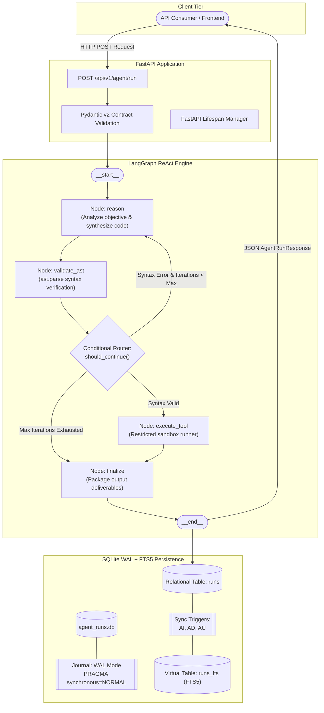
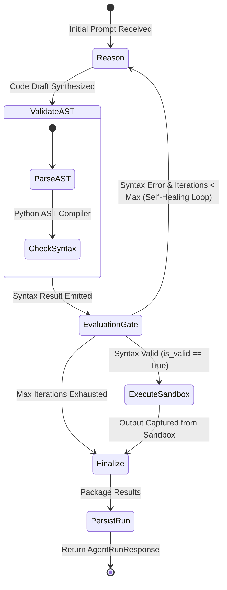

# Prompt-to-Code ReAct Agent (`01-prompt-to-code-react-agent`)

[](https://www.python.org/downloads/)
[](https://fastapi.tiangolo.com/)
[](https://langchain-ai.github.io/langgraph/)
[](https://www.sqlite.org/)
[]()
[]()

Production-grade ReAct (Reasoning + Acting) autonomous code generation agent built with FastAPI, LangGraph, Pydantic v2, and SQLite in Write-Ahead Logging (WAL) mode with Full-Text Search 5 (FTS5) triggers and BM25 ranking.

---

## 1. Executive Summary & Capabilities

The **Prompt-to-Code ReAct Agent** accepts natural language programming instructions, iteratively reasons about program design, synthesizes source code, verifies syntax integrity using Python's Abstract Syntax Tree (`ast.parse`), and executes validated programs in an isolated runtime sandbox.

### Key Capabilities
- **Autonomous ReAct Loop**: Alternates between reasoning thoughts, code synthesis actions, AST observations, and sandboxed execution.
- **Self-Healing Syntax Recovery**: When AST validation detects syntax errors (e.g., missing brackets, unexpected EOF), the error details are injected back into the reasoning node to correct the syntax within the iteration budget.
- **Zero External API Flakiness**: Equipped with a deterministic mock reasoning engine for 100% offline, reproducible CI/CD execution with zero API keys required.
- **High-Performance Persistence**: Every run is logged to SQLite in WAL mode with real-time FTS5 full-text indexing via automated database triggers.
- **Production-Ready Operations**: Multi-stage Dockerfile, non-root security user, `/health/live` and `/health/ready` probes, and RFC 7807 error responses.

---

## 2. System Architecture & Workflow Diagram



---

## 3. LangGraph State Machine Specification



### State Schema

| State Key | Type | Reducer | Description |
|---|---|---|---|
| `prompt` | `str` | Overwrite | Natural language user programming specification |
| `language` | `str` | Overwrite | Programming language target (`python`) |
| `code` | `str` | Overwrite | Synthesized source code implementation |
| `is_valid` | `bool` | Overwrite | AST validation pass/fail status |
| `output` | `Optional[str]` | Overwrite | Captured execution stdout or error detail |
| `steps` | `list[str]` | `operator.add` | Cumulative trace of thoughts, actions, and observations |
| `iterations` | `int` | Overwrite | Current iteration count |
| `max_iterations`| `int` | Overwrite | Maximum iteration budget limit |
| `completed` | `bool` | Overwrite | Run completion flag |
| `error` | `Optional[str]` | Overwrite | Syntax or runtime error message |

---

## 4. SQLite WAL Mode & FTS5 Configuration

All database interactions operate in SQLite Write-Ahead Logging (WAL) mode to guarantee high-concurrency non-blocking reads and durable writes.

### WAL Pragmas
Executed upon connection initialization:
```sql
PRAGMA journal_mode = WAL;
PRAGMA synchronous = NORMAL;
PRAGMA busy_timeout = 5000;
PRAGMA foreign_keys = ON;
```

### Relational Schema with FTS5 Synchronization Triggers
```sql
CREATE TABLE IF NOT EXISTS runs (
    id TEXT PRIMARY KEY,
    prompt TEXT NOT NULL,
    language TEXT NOT NULL,
    code TEXT NOT NULL,
    is_valid INTEGER NOT NULL,
    output TEXT,
    iterations INTEGER NOT NULL,
    steps TEXT NOT NULL,
    status TEXT NOT NULL,
    created_at TIMESTAMP DEFAULT CURRENT_TIMESTAMP
);

CREATE VIRTUAL TABLE IF NOT EXISTS runs_fts USING fts5(
    prompt,
    code,
    output,
    content='runs',
    content_rowid='rowid',
    tokenize = 'porter unicode61'
);

CREATE TRIGGER IF NOT EXISTS trg_runs_ai AFTER INSERT ON runs BEGIN
    INSERT INTO runs_fts(rowid, prompt, code, output)
    VALUES (new.rowid, new.prompt, new.code, coalesce(new.output, ''));
END;

CREATE TRIGGER IF NOT EXISTS trg_runs_ad AFTER DELETE ON runs BEGIN
    INSERT INTO runs_fts(runs_fts, rowid, prompt, code, output)
    VALUES('delete', old.rowid, old.prompt, old.code, coalesce(old.output, ''));
END;

CREATE TRIGGER IF NOT EXISTS trg_runs_au AFTER UPDATE ON runs BEGIN
    INSERT INTO runs_fts(runs_fts, rowid, prompt, code, output)
    VALUES('delete', old.rowid, old.prompt, old.code, coalesce(old.output, ''));
    INSERT INTO runs_fts(rowid, prompt, code, output)
    VALUES (new.rowid, new.prompt, new.code, coalesce(new.output, ''));
END;
```

---

## 5. Tech Stack & Engineering Standards

| Component | Technology | Version | Purpose |
|---|---|---|---|
| **API Framework** | FastAPI | `^0.110.0` | REST API routes, lifespan lifecycle, dependency injection |
| **Agent Engine** | LangGraph | `^0.0.30` | StateGraph execution, conditional routing, state reducers |
| **Data Validation** | Pydantic v2 | `^2.6.0` | Strict request/response DTOs, boundary constraint validation |
| **Configuration** | Pydantic Settings | `^2.2.0` | Environment variable parsing with `.env` support |
| **Async Storage** | aiosqlite | `^0.20.0` | Asynchronous SQLite connection pool |
| **Full-Text Search** | SQLite FTS5 | Native 3.45+ | BM25 lexical ranking and snippet generation |
| **Testing** | Pytest + pytest-asyncio | `^8.0.0` | 5-tier test pyramid, zero offline failures |
| **Containerization** | Docker | 20+ | Multi-stage unprivileged build |

---

## 6. Repository Layout

```text
01-prompt-to-code-react-agent/
├── pyproject.toml              # PEP 518/621 packaging & dependencies
├── requirements.txt            # Pinned runtime dependencies
├── Dockerfile                  # Multi-stage production container build
├── docker-compose.yml          # Container orchestration with volume mounts
├── pytest.ini                  # Pytest configuration and tier markers
├── .env.example                # Environment variable template
├── .gitignore                  # Python, SQLite & environment exclusions
├── README.md                   # 12-section architecture documentation
├── app/
│   ├── __init__.py
│   ├── main.py                 # FastAPI application with lifespan context manager
│   ├── config.py               # Pydantic Settings configuration
│   ├── database.py             # SQLite WAL engine & FTS5 triggers
│   ├── models.py               # Pydantic v2 schemas and domain DTOs
│   ├── agent/
│   │   ├── __init__.py
│   │   ├── state.py            # TypedDict state schema
│   │   ├── nodes.py            # reason, validate_ast, execute_tool, finalize
│   │   ├── graph.py            # StateGraph compilation & should_continue routing
│   │   └── mock_llm.py         # Deterministic offline mock LLM engine
│   └── routers/
│       ├── __init__.py
│       ├── health.py           # /health/live, /health/ready probes
│       └── agent.py            # Run execution, history, and FTS5 search
└── tests/
    ├── __init__.py
    ├── conftest.py             # Reusable fixtures (temp_db, test_client)
    ├── test_schemas.py         # Tier 1: Pydantic schema validation tests
    ├── test_agent_graph.py     # Tier 2: LangGraph node & edge tests
    ├── test_persistence.py     # Tier 3: SQLite WAL pragmas, triggers & BM25
    ├── test_api_contracts.py   # Tier 4: FastAPI TestClient HTTP contract tests
    └── test_boundary_resilience.py # Tier 5: Boundary conditions & concurrency
```

---

## 7. Prerequisites & Environment Setup

### System Prerequisites
- Python 3.11+ (Python 3.13 supported)
- SQLite 3.40+ with FTS5 extension enabled (standard with Python binary)
- Docker Engine & Docker Compose (for containerized execution)

### Setup Instructions

```bash
# Clone or navigate to the repository
cd 01-prompt-to-code-react-agent

# Create virtual environment
python -m venv .venv

# Activate virtual environment
# Windows (PowerShell):
.venv\Scripts\Activate.ps1
# Linux / macOS / WSL2:
source .venv/bin/activate

# Install runtime and development dependencies
pip install -r requirements.txt
```

---

## 8. Configuration & Environment Variables

Copy `.env.example` to `.env` to configure runtime parameters:

```bash
cp .env.example .env
```

| Key | Default | Description |
|---|---|---|
| `DATABASE_PATH` | `data/agent_runs.db` | Filesystem path for SQLite WAL database |
| `ENVIRONMENT` | `development` | Runtime environment name (`development`, `production`, `test`) |
| `LOG_LEVEL` | `INFO` | Application logging verbosity (`DEBUG`, `INFO`, `WARNING`, `ERROR`) |
| `MAX_ITERATIONS` | `5` | Maximum ReAct loop iteration budget |
| `HOST` | `0.0.0.0` | Bind host for Uvicorn HTTP server |
| `PORT` | `8000` | Port for Uvicorn HTTP server |

---

## 9. Usage Guide & REST API Endpoints

### Starting the Application Server

```bash
uvicorn app.main:app --host 0.0.0.0 --port 8000 --reload
```

### API Endpoints Reference

| Method | Path | Request Body | Response Body | Description |
|---|---|---|---|---|
| `GET` | `/health/live` | None | `{"status": "live"}` | Kubernetes liveness probe |
| `GET` | `/health/ready` | None | `HealthResponse` | Readiness probe (DB & WAL check) |
| `POST` | `/api/v1/agent/run` | `AgentRunRequest` | `AgentRunResponse` | Trigger code generation ReAct run |
| `GET` | `/api/v1/agent/runs` | Query (`limit`) | `list[AgentRunResponse]` | Retrieve recent runs history |
| `GET` | `/api/v1/agent/runs/search` | Query (`q`, `limit`) | `list[RunSearchResult]` | Ranked BM25 full-text search |
| `GET` | `/api/v1/agent/runs/{id}` | Path (`run_id`) | `AgentRunResponse` | Retrieve single run by ID |

### cURL Examples

#### 1. Trigger Code Generation
```bash
curl -X POST "http://localhost:8000/api/v1/agent/run" \
  -H "Content-Type: application/json" \
  -d '{
    "prompt": "Write a python function to compute factorial of n",
    "language": "python",
    "max_iterations": 5
  }'
```

*Sample Response:*
```json
{
  "run_id": "run_9a8b7c6d5e4f",
  "prompt": "Write a python function to compute factorial of n",
  "language": "python",
  "code": "def factorial(n: int) -> int:\n    if n < 0:\n        raise ValueError('Negative inputs undefined')\n    if n in (0, 1):\n        return 1\n    return n * factorial(n - 1)\n\nif __name__ == '__main__':\n    print(f'Factorial(5): {factorial(5)}')\n",
  "is_valid": true,
  "output": "Factorial(5): 120",
  "iterations": 1,
  "steps": [
    "Thought: Requirements specify factorial computation. Implementing recursive factorial function.",
    "Action: Synthesized 11 lines of python code.",
    "Observation: AST syntax validation passed with zero errors.",
    "Action: Executed sandbox runner. Captured stdout: 'Factorial(5): 120'",
    "Finalize: Packaging completed run deliverables."
  ],
  "status": "completed",
  "created_at": "2026-11-02 21:45:00"
}
```

#### 2. Search Run History (BM25)
```bash
curl "http://localhost:8000/api/v1/agent/runs/search?q=factorial"
```

---

## 10. Verification & Pytest Test Suite

The test suite enforces a 5-tier verification pyramid executing offline without external network dependencies.

```bash
# Execute all tests with short traceback
python -m pytest tests/ -v

# Run with test coverage report
python -m pytest --cov=app --cov-report=term-missing tests/
```

### Test Case Inventory (40 Tests, 100% Pass Rate)

| Tier | File | Test Function | Purpose / Assertion |
|---|---|---|---|
| **Tier 1: Schemas** | `test_schemas.py` | `test_agent_run_request_valid` | Validates valid request instantiation |
| | | `test_agent_run_request_defaults` | Checks default language and iteration values |
| | | `test_agent_run_request_empty_prompt_raises` | Asserts empty prompt raises `ValidationError` |
| | | `test_agent_run_request_whitespace_stripping` | Asserts whitespace stripping on input strings |
| | | `test_agent_run_request_bounds` | Asserts bounds enforcement on `max_iterations` |
| | | `test_agent_run_request_extra_fields_forbidden` | Asserts extra fields are rejected |
| | | `test_code_execution_result` | Validates `CodeExecutionResult` schema |
| | | `test_agent_run_response_serialization` | Verifies `model_dump` and `model_dump_json` |
| | | `test_run_search_result` | Validates `RunSearchResult` model |
| | | `test_health_response_schema` | Validates `HealthResponse` schema |
| **Tier 2: Graph** | `test_agent_graph.py` | `test_reason_node_increments_iterations_and_logs_steps` | Asserts `reason_node` increments iteration |
| | | `test_validate_ast_node_success` | Asserts `validate_ast_node` validates correct code |
| | | `test_validate_ast_node_syntax_error` | Asserts `validate_ast_node` catches syntax error line |
| | | `test_execute_tool_node_captures_stdout` | Asserts sandbox runner captures stdout |
| | | `test_execute_tool_node_handles_runtime_exception` | Asserts sandbox runner isolates exceptions |
| | | `test_finalize_node` | Asserts `finalize_node` marks state completed |
| | | `test_should_continue_routing` | Validates conditional edge routing logic |
| | | `test_graph_end_to_end_execution` | Full graph run on factorial task |
| | | `test_graph_self_healing_recovery_loop` | Verifies self-healing recovery on syntax error |
| | | `test_graph_max_iterations_exhaustion` | Verifies termination on iteration budget limit |
| **Tier 3: Persistence** | `test_persistence.py` | `test_sqlite_wal_mode_pragmas` | Verifies WAL mode, busy timeout, foreign keys |
| | | `test_save_and_retrieve_run` | Inserts and reads run from database |
| | | `test_list_runs_pagination` | Verifies listing runs honors limit |
| | | `test_fts5_synchronization_triggers` | Verifies insert, update, delete trigger sync |
| | | `test_fts5_bm25_search_scoring` | Verifies BM25 ranking and snippet highlighting |
| | | `test_database_health_check` | Asserts database health reports connected WAL |
| **Tier 4: API** | `test_api_contracts.py` | `test_liveness_probe` | Validates `GET /health/live` returns 200 OK |
| | | `test_readiness_probe` | Validates `GET /health/ready` returns 200 OK |
| | | `test_general_health` | Validates `GET /health` returns 200 OK |
| | | `test_post_agent_run` | Validates `POST /api/v1/agent/run` contract |
| | | `test_get_recent_runs_empty_and_populated` | Validates `GET /api/v1/agent/runs` |
| | | `test_get_single_run_by_id` | Validates `GET /api/v1/agent/runs/{id}` |
| | | `test_get_single_run_not_found_rfc7807` | Asserts 404 with RFC 7807 problem details |
| | | `test_search_runs_endpoint` | Validates `GET /api/v1/agent/runs/search` |
| | | `test_run_agent_validation_error` | Asserts HTTP 422 on invalid payload |
| **Tier 5: Boundary** | `test_boundary_resilience.py` | `test_extremely_large_prompt_resilience` | Tests large 5,000 character prompt |
| | | `test_sql_injection_resilience_in_fts5_search` | Tests SQL injection and special character queries |
| | | `test_ast_validation_empty_and_corrupt_payloads`| Tests empty and malformed string states |
| | | `test_sandbox_runtime_error_resilience` | Tests zero division isolation |
| | | `test_concurrent_wal_writes` | Tests 50 concurrent writes across 5 tasks |

---

## 11. Docker & Containerized Deployment

### Multi-Stage Build
The `Dockerfile` employs a multi-stage architecture:
1. **Builder Stage (`python:3.11-slim`)**: Compiles native C-extensions (`build-essential`) and installs dependencies to `/root/.local`.
2. **Runner Stage (`python:3.11-slim`)**: Copies compiled dependencies to an unprivileged `appuser` (UID 1000), binds `/app/data` volume, and launches Uvicorn.

### Building & Running with Docker Compose

```bash
# Build and start container in detached mode
docker compose up --build -d

# Check service logs
docker compose logs -f

# Verify container health
docker compose ps

# Teardown container and volumes
docker compose down -v
```

---

## 12. Production & EC2 Deployment Notes

When deploying to AWS EC2 or standalone Linux virtual machines:
- **EBS Volume Mount**: Mount `/app/data` onto an Amazon EBS (gp3) volume to ensure SQLite WAL log files (`agent_runs.db`, `agent_runs.db-wal`, `agent_runs.db-shm`) persist independently of container lifecycles.
- **WAL Checkpointing**: SQLite automatically checkpoints the WAL file when it reaches 1,000 pages (~4MB). For heavy write workloads, a scheduled background task can invoke `PRAGMA wal_checkpoint(TRUNCATE);`.
- **Systemd Service**: When deploying outside Docker, manage Uvicorn using systemd:
  ```ini
  [Unit]
  Description=Prompt-to-Code ReAct Agent
  After=network.target

  [Service]
  User=appuser
  WorkingDirectory=/opt/prompt-to-code-react-agent
  ExecStart=/opt/prompt-to-code-react-agent/.venv/bin/uvicorn app.main:app --host 0.0.0.0 --port 8000
  Restart=always
  RestartSec=5

  [Install]
  WantedBy=multi-user.target
  ```
- **Reverse Proxy**: Place behind Nginx or AWS Application Load Balancer (ALB) terminating SSL/TLS and forwarding traffic to `http://localhost:8000`.
