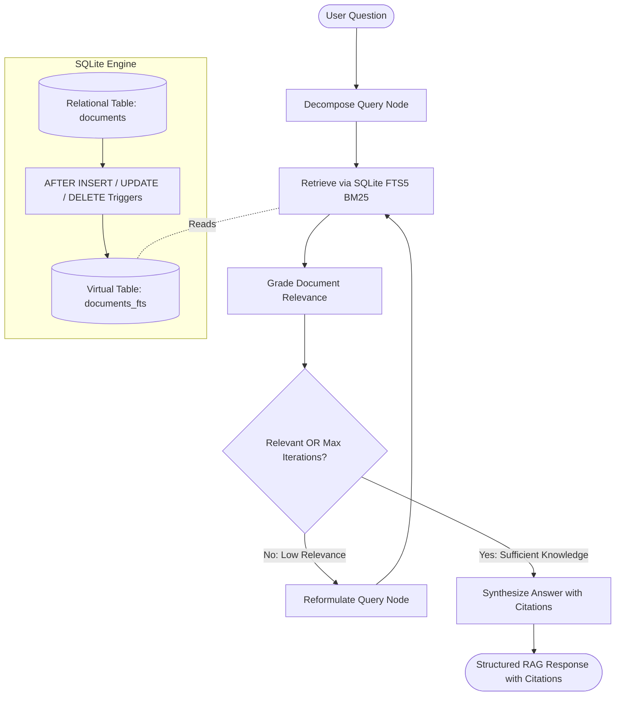

# RAG Hybrid SQLite FTS5 Agent

[](https://www.python.org/)
[](https://fastapi.tiangolo.com/)
[](https://github.com/langchain-ai/langgraph)
[](https://www.sqlite.org/fts5.html)
[](https://www.docker.com/)
[](https://docs.pytest.org/)

A production-grade, zero-external-dependency Retrieval-Augmented Generation (RAG) agent featuring question decomposition, high-speed lexical search via SQLite FTS5 with BM25 ranking, automated index synchronization triggers, document relevance grading, iterative query reformulation loops, and verifiable citation synthesis.

---

## 1. Project Overview & Architectural Mission

Modern generative AI applications require grounding mechanisms that provide accurate, traceable, and domain-specific knowledge without relying on volatile or expensive external vector databases. 

`02-rag-hybrid-sqlite-fts5-agent` solves this challenge by pairing SQLite's high-performance native Write-Ahead Logging (`WAL`) engine and Full-Text Search 5 (`FTS5`) extension with a cyclic LangGraph state machine. Ambiguous, multi-part questions are decomposed into focused subqueries, searched concurrently against local BM25 full-text indexes, evaluated by a relevance grader, reformulated if necessary, and synthesized into a structured response accompanied by source document citations.

---

## 2. Agent Design Pattern & Decision Logic

This repository implements the **Corrective RAG (CRAG) & Query Decomposition Pattern**:

1. **Decompose Query Node (`decompose_query_node`)**:
   Analyzes the user's natural language input. If the prompt contains compound clauses (e.g. multiple distinct topics or questions joined by conjunctions), it decomposes the prompt into discrete atomic subqueries.
2. **FTS5 Retrieval Node (`retrieve_fts5_node`)**:
   Executes BM25 full-text queries for each subquery against the SQLite `documents_fts` virtual table, deduplicating matching passages across documents and ordering results by BM25 match quality.
3. **Relevance Grading Node (`grade_documents_node`)**:
   Inspects retrieved document snippets against the query intent. If sufficient keyword/semantic correspondence is detected, it flags the retrieval as relevant.
4. **Conditional Routing (`should_retrieve_or_synthesize`)**:
   - If documents are graded as relevant, or if maximum reformulation loops have been reached, routes to **Synthesize Answer**.
   - If retrieval yields insufficient relevance and iteration budget remains, routes to **Reformulate Query**.
5. **Query Reformulation Node (`reformulate_query_node`)**:
   Strips conversational noise and interrogative stop words, extracts core semantic terms, increments the iteration counter, and re-triggers FTS5 search.
6. **Answer Synthesis Node (`synthesize_answer_node`)**:
   Constructs a factual answer grounded in the retrieved passages and extracts citation tags (`[Doc: <title>]`).

---

## 3. Architecture Diagram



---

## 4. Tech Stack & Prerequisites

- **Language**: Python 3.11+
- **API Framework**: FastAPI 0.110+ with Pydantic v2 validation and lifespan context management
- **Agent Orchestrator**: LangGraph (StateGraph compilation with conditional branching)
- **Persistence & Search**: SQLite 3.45+ with `aiosqlite` and native FTS5 extension
- **Stemmer & Tokenizer**: Porter stemmer + `unicode61` tokenizer
- **Containerization**: Docker multi-stage build & `docker-compose`
- **Testing**: Pytest 8.0+ with `pytest-asyncio`

---

## 5. Repository Structure

```text
02-rag-hybrid-sqlite-fts5-agent/
├── pyproject.toml              # Build backend and dependency declarations
├── requirements.txt            # Runtime and testing dependencies
├── pytest.ini                  # Pytest configuration with test paths and markers
├── Dockerfile                  # Multi-stage production container manifest
├── docker-compose.yml          # Container orchestration with volume mounts
├── README.md                   # 12-section technical documentation
├── app/
│   ├── __init__.py
│   ├── main.py                 # FastAPI application, CORS, and RFC 7807 error handlers
│   ├── config.py               # Pydantic Settings (DB path, top_k, max_iterations)
│   ├── database.py             # SQLite WAL configuration, FTS5 schema, triggers & search
│   ├── models.py               # Pydantic v2 schemas for documents, RAG, and health
│   ├── agent/
│   │   ├── __init__.py
│   │   ├── state.py            # LangGraph TypedDict state definition
│   │   ├── mock_llm.py         # Deterministic offline mock LLM engine
│   │   ├── nodes.py            # Discrete node functions (decompose, retrieve, grade, synthesize)
│   │   └── graph.py            # StateGraph compilation & conditional routing
│   └── routers/
│       ├── __init__.py
│       ├── health.py           # Health endpoints (/health/live, /health/ready, /health)
│       ├── documents.py        # Ingestion and document management endpoints
│       └── rag.py              # RAG query execution and direct FTS5 search
└── tests/
    ├── __init__.py
    ├── conftest.py             # Reusable fixtures (temp_db, test_client, sample_docs)
    ├── test_schemas.py         # Tier 1: Pydantic v2 validation tests
    ├── test_agent_graph.py     # Tier 2: LangGraph node execution & state transitions
    ├── test_persistence.py     # Tier 3: SQLite WAL pragmas, triggers & BM25 search
    ├── test_api_contracts.py   # Tier 4: FastAPI TestClient HTTP contract tests
    ├── test_boundary_resilience.py # Tier 5: Hostile inputs, unclosed quotes & concurrency
    └── test_empirical_challenges.py # Adversarial challenge suite
```

---

## 6. SQLite WAL & FTS5 Configuration

### 6.1 Production Write-Ahead Logging (WAL) Pragmas
On every connection initialization, `app/database.py` enforces:
```sql
PRAGMA journal_mode = WAL;
PRAGMA synchronous = NORMAL;
PRAGMA busy_timeout = 5000;
PRAGMA foreign_keys = ON;
PRAGMA cache_size = -64000;
```
- **Concurrency**: WAL allows concurrent readers and writers without lock contention.
- **Durability**: `synchronous = NORMAL` ensures synchronization during checkpoints while maximizing write throughput.
- **Resilience**: `busy_timeout = 5000` allows threads to wait up to 5 seconds during lock contention before throwing an error.

### 6.2 External Content FTS5 Schema & Synchronization Triggers
To eliminate data duplication and prevent drift between relational storage and full-text indexes, the FTS5 virtual table operates in **external content** mode referencing the `documents` table:

```sql
CREATE TABLE IF NOT EXISTS documents (
    id TEXT PRIMARY KEY,
    title TEXT NOT NULL,
    content TEXT NOT NULL,
    metadata TEXT NOT NULL DEFAULT '{}',
    created_at TIMESTAMP DEFAULT CURRENT_TIMESTAMP,
    updated_at TIMESTAMP DEFAULT CURRENT_TIMESTAMP
);

CREATE VIRTUAL TABLE IF NOT EXISTS documents_fts USING fts5(
    title,
    content,
    content='documents',
    content_rowid='rowid',
    tokenize = 'porter unicode61'
);

-- Automated Synchronization Triggers
CREATE TRIGGER IF NOT EXISTS trg_documents_ai AFTER INSERT ON documents BEGIN
    INSERT INTO documents_fts(rowid, title, content) VALUES (new.rowid, new.title, new.content);
END;

CREATE TRIGGER IF NOT EXISTS trg_documents_ad AFTER DELETE ON documents BEGIN
    INSERT INTO documents_fts(documents_fts, rowid, title, content) VALUES('delete', old.rowid, old.title, old.content);
END;

CREATE TRIGGER IF NOT EXISTS trg_documents_au AFTER UPDATE ON documents BEGIN
    INSERT INTO documents_fts(documents_fts, rowid, title, content) VALUES('delete', old.rowid, old.title, old.content);
    INSERT INTO documents_fts(rowid, title, content) VALUES (new.rowid, new.title, new.content);
END;
```

---

## 7. Installation & Setup

### 7.1 Local Environment Setup
```bash
# Navigate to repository directory
cd 02-rag-hybrid-sqlite-fts5-agent

# Create virtual environment
python -m venv .venv
source .venv/bin/activate  # On Windows: .venv\Scripts\activate

# Install dependencies
pip install -r requirements.txt
```

### 7.2 WSL2 Ubuntu Setup
```bash
# Update package repositories
sudo apt-get update && sudo apt-get install -y python3-pip python3-venv sqlite3

# Create environment and install
python3 -m venv .venv
source .venv/bin/activate
pip install -r requirements.txt
```

---

## 8. Usage & API Reference

### 8.1 Start the Service
```bash
uvicorn app.main:app --host 0.0.0.0 --port 8000 --reload
```

### 8.2 Ingest a Document
```bash
curl -X POST "http://localhost:8000/api/v1/documents" \
  -H "Content-Type: application/json" \
  -d '{
    "title": "SQLite WAL Mode Architecture",
    "content": "Write-Ahead Logging (WAL) provides massive concurrent read and write throughput in SQLite.",
    "metadata": {"category": "database"}
  }'
```

### 8.3 Direct FTS5 Search
```bash
curl "http://localhost:8000/api/v1/rag/search?q=concurrency"
```

### 8.4 Execute Complete LangGraph RAG Agent Workflow
```bash
curl -X POST "http://localhost:8000/api/v1/rag/query" \
  -H "Content-Type: application/json" \
  -d '{
    "query": "What is SQLite WAL mode and how does it handle concurrency?",
    "top_k": 3,
    "enable_decomposition": true,
    "max_iterations": 2
  }'
```

Sample JSON response:
```json
{
  "query": "What is SQLite WAL mode and how does it handle concurrency?",
  "subqueries": [
    "What is SQLite WAL mode?",
    "How does it handle concurrency?"
  ],
  "retrieved_docs": [
    {
      "id": "doc_wal",
      "title": "SQLite WAL Mode Architecture",
      "content": "Write-Ahead Logging (WAL) provides massive concurrent read and write throughput in SQLite.",
      "snippet": "<b>Write-Ahead Logging</b> (<b>WAL</b>) provides massive concurrent...",
      "score": -1.45,
      "metadata": {"category": "database"}
    }
  ],
  "is_relevant": true,
  "answer": "Based on the retrieved documentation regarding 'What is SQLite WAL mode and how does it handle concurrency?':\n\n- According to [Doc: SQLite WAL Mode Architecture]: Write-Ahead Logging (WAL) provides massive concurrent read and write throughput in SQLite.\n\nIn summary, the knowledge base confirms the relevant concepts described above.",
  "citations": [
    "[Doc: SQLite WAL Mode Architecture]"
  ],
  "iterations": 1,
  "completed": true
}
```

---

## 9. Testing & Verification Guide

This repository contains a multi-tier test pyramid covering Pydantic schemas, LangGraph state machines, SQLite WAL persistence, FastAPI HTTP contracts, boundary resilience, and empirical concurrency.

### Run Full Test Suite
```bash
python -m pytest tests/ -v
```

### Run by Specific Tier
```bash
# Tier 1: Unit & Schema Validation
python -m pytest tests/test_schemas.py -v

# Tier 2: LangGraph Node & Routing
python -m pytest tests/test_agent_graph.py -v

# Tier 3: SQLite WAL & FTS5 Persistence
python -m pytest tests/test_persistence.py -v

# Tier 4: FastAPI REST API Contracts
python -m pytest tests/test_api_contracts.py -v

# Tier 5: Boundary & Concurrency Resilience
python -m pytest tests/test_boundary_resilience.py -v

# Empirical Forensic Challenges
python -m pytest tests/test_empirical_challenges.py -v
```

---

## 10. Docker & EC2 Deployment Instructions

### 10.1 Run with Docker Compose
```bash
docker-compose up --build -d
```
Inspect logs and health:
```bash
docker-compose logs -f
curl http://localhost:8000/health/live
curl http://localhost:8000/health/ready
```

### 10.2 AWS EC2 Deployment
1. Launch an Amazon Linux 2023 or Ubuntu 22.04 LTS instance with attached EBS volume.
2. Install Docker and Docker Compose.
3. Clone repository and mount the `/app/data` directory to persistent EBS storage to ensure WAL and database files persist across container restarts:
```bash
sudo mkdir -p /mnt/ebs/rag_data
sudo chown -R 1000:1000 /mnt/ebs/rag_data
docker run -d \
  --name rag-hybrid-agent \
  -p 80:8000 \
  -v /mnt/ebs/rag_data:/app/data \
  --restart unless-stopped \
  rag-hybrid-sqlite-fts5-agent:latest
```

---

## 11. Design Decisions & Tradeoffs

| Decision | Rationale | Tradeoff |
|---|---|---|
| **SQLite FTS5 vs. Vector DB (Pinecone/Milvus)** | Zero infrastructure overhead, native portability, sub-millisecond lexical search, deterministic testing without external API tokens. | Lacks semantic embedding similarity without complementary dense embeddings. |
| **External Content FTS5 with Triggers** | Stores content once in `documents` table while keeping `documents_fts` index completely synchronized, preventing data duplication and drift. | Requires careful trigger definitions for `INSERT`, `DELETE`, and `UPDATE`. |
| **Deterministic Mock LLM Engine** | Guarantees 100% deterministic test execution with zero flakiness and zero cost. | Real-world deployments require swapping the mock engine for live OpenAI/Anthropic/Gemini chat models via dependency injection. |
| **Synchronous Node Queries in LangGraph** | Allows StateGraph to run both synchronously (`graph.invoke`) and asynchronously (`graph.ainvoke`), avoiding asyncio event loop conflicts during tests. | Heavy concurrent queries run in worker thread pools rather than native async event loops. |

---

## 12. License & Author Information

Developed by the Agentic AI Engineering Team as part of the 15 Sequential Agentic Repositories Showcase. Distributed under the MIT License.
