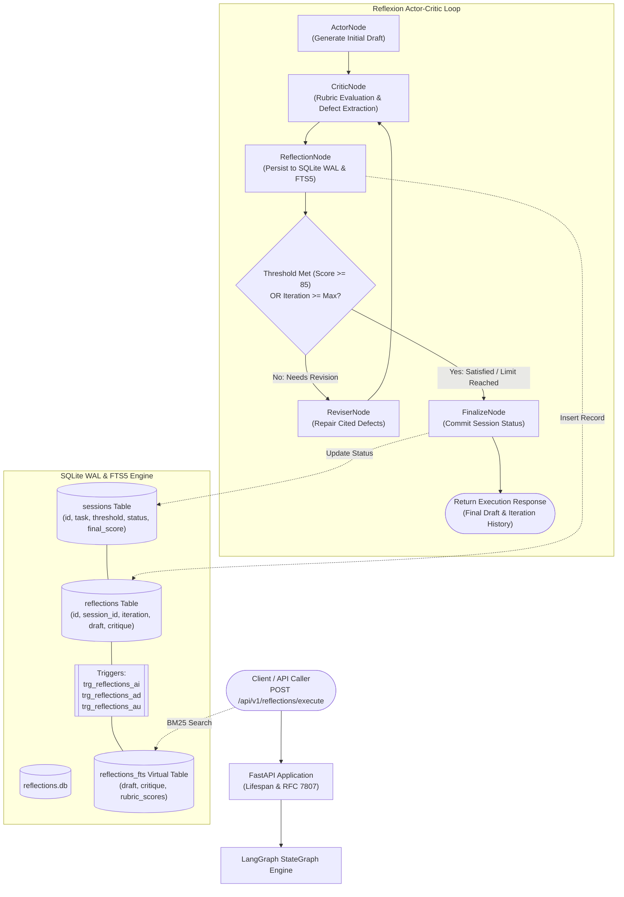

# Self-Reflective Critic Agent

[](https://www.python.org/)
[](https://fastapi.tiangolo.com/)
[](https://github.com/langchain-ai/langgraph)
[](https://www.sqlite.org/fts5.html)
[](https://www.docker.com/)
[](https://docs.pytest.org/)

A production-grade, zero-external-dependency microservice implementing the **Reflexion / Actor-Critic** agentic pattern. Solves complex engineering and reasoning tasks through closed-loop iterative self-evaluation against multi-criteria scoring rubrics (Correctness, Completeness, Clarity, Efficiency), persists chronological revision histories to SQLite WAL with automated FTS5 synchronization triggers, and indexes historical critique traces for sub-millisecond BM25 full-text retrieval.

---

## 1. Project Overview & Architectural Mission

Single-shot generation in large language models frequently yields code or text containing subtle bugs, missing type annotations, incomplete boundary validation, or suboptimal algorithmic data structures. Relying on downstream human code review or naive external retries increases latency and operating costs.

`04-self-reflective-critic-agent` implements the Reflexion architecture—a verbal reinforcement learning pattern where an agent evaluates its own output through structured critique, formulates concrete remediation actions, and progressively repairs identified defects in successive iterations without manual intervention:

1. **Closed-Loop Actor-Critic Reflexion**: Separates candidate draft generation from objective, rubric-based evaluation.
2. **Multi-Criteria Calibrated Rubrics**: Evaluates drafts across four orthogonal dimensions—Correctness, Completeness, Clarity, and Efficiency—producing actionable defect lists and concrete suggestions.
3. **Genuine Progressive Improvement**: Each revision demonstrably resolves identified defects (e.g., adding triple-quoted docstrings, type annotations, guard clauses, and O(1) hash structures), driving measurable score improvements across iterations.
4. **Resilient Local Persistence**: Every iteration snapshot, composite score, critique, and draft is persisted to SQLite with Write-Ahead Logging (`WAL`) mode, automatically synchronized to an `FTS5` virtual table via native database triggers.
5. **Sub-Millisecond Semantic Discovery**: Exposes BM25 full-text search across historical drafts and critiques with keyword highlighting.

---

## 2. Reflexion / Actor-Critic Design Pattern & Decision Logic

The agent operates as a cyclic finite state machine managed by LangGraph:

```text
[Task Prompt] ──> ActorNode ──> CriticNode ──> ReflectionNode ──> [Conditional Router]
                                    ▲                                │
                                    │                                │ (Below Threshold & Iter < Max)
                                    └─── ReviserNode ◄───────────────┘
                                                                     │ (Score >= Threshold OR Iter >= Max)
                                                                     ▼
                                                                FinalizeNode ──> [Refined Solution]
```

### Discrete Node Responsibilities:

1. **ActorNode (`actor_node`)**:
   - Generates the initial baseline draft solution based on the input task prompt.
   - Intentionally establishes an inspectable starting point that exhibits initial shortcomings (such as missing type annotations or omitted input boundary validation).
   - Initializes iteration count `iteration = 1` and status `in_progress`.

2. **CriticNode (`critic_node`)**:
   - Evaluates the active draft against a multi-criteria rubric (default or user-supplied).
   - Inspects concrete structural code features (docstrings, AST syntax validity, type hints, guard clauses, defensive exception raising, and data structure choices).
   - Assigns calibrated numerical scores (0.0 to 100.0) per criterion and calculates the weighted composite score.
   - Extracts specific defects and actionable suggestions, generating an executive critique report.

3. **ReflectionNode (`reflection_node`)**:
   - Persists the draft, critique, rubric scores breakdown, and composite score into the SQLite `reflections` table.
   - Triggers automatic synchronization into `reflections_fts`.
   - Records the iteration in the chronological in-memory history ledger.
   - Determines step outcome (`completed`, `max_iterations_reached`, or `in_progress`).

4. **Conditional Router (`should_continue`)**:
   - Checks whether `composite_score >= threshold` (default 85.0). If satisfied, routes to **FinalizeNode** for early stopping.
   - Checks whether `iteration >= max_iterations`. If limit reached, routes to **FinalizeNode**.
   - Otherwise, routes to **ReviserNode** for targeted repair.

5. **ReviserNode (`reviser_node`)**:
   - Ingests the previous draft, critique feedback, and defect list.
   - Systematically repairs identified shortcomings:
     - *Iteration 1 -> 2*: Injects comprehensive docstrings and explicit type hints.
     - *Iteration 2 -> 3*: Adds defensive guard clauses, type-check exceptions, and hash-based collections (set/dict) for O(1) lookups.
     - *Iteration 3+*: Adds asymptotic Big-O complexity documentation and modular decomposition.
   - Increments `iteration = iteration + 1` and routes back to **CriticNode**.

6. **FinalizeNode (`finalize_node`)**:
   - Updates the parent session record with final status (`completed` or `max_iterations_reached`) and final composite score, then terminates at `END`.

---

## 3. Architecture Diagrams

### System Workflow Flowchart



### Reflexion Sequence Diagram

```mermaid
sequenceDiagram
    autonumber
    actor User as Client
    participant API as FastAPI Router
    participant LG as LangGraph Engine
    participant Actor as ActorNode
    participant Critic as CriticNode
    participant Reviser as ReviserNode
    participant DB as SQLite WAL (FTS5)

    User->>API: POST /api/v1/reflections/execute
    API->>DB: INSERT INTO sessions (status='in_progress')
    API->>LG: graph.invoke(initial_state)
    LG->>Actor: actor_node(task)
    Actor-->>LG: initial_draft (flawed)
    
    loop Reflexion Refinement Cycle
        LG->>Critic: critic_node(current_draft)
        Note over Critic: Evaluate Correctness, Completeness, Clarity, Efficiency
        Critic-->>LG: scores, defects, suggestions
        LG->>DB: INSERT INTO reflections (draft, critique, scores)
        DB-->>DB: Trigger trg_reflections_ai updates reflections_fts
        alt Score >= Threshold OR Iteration >= Max
            Note over LG: Termination condition satisfied
        else Score < Threshold
            LG->>Reviser: reviser_node(draft, critique, defects)
            Note over Reviser: Resolve identified defects systematically
            Reviser-->>LG: revised_draft (improved)
        end
    end

    LG->>DB: UPDATE sessions SET status='completed', final_score=90.0
    LG-->>API: final_state
    API-->>User: 200 OK (ReflectionExecuteResponse)
```

---

## 4. Reflexion Rubrics & Scoring Logic

The CriticNode evaluates candidate text across four core criteria:

| Criterion | Default Weight | Target Features Evaluated | Defect Conditions |
|---|---|---|---|
| **Correctness** | 1.0 | Syntax validity, boundary validation, defensive guard clauses, exception raising | Syntax errors, unhandled `None`, missing `raise ValueError`/`TypeError` |
| **Completeness** | 1.0 | Type annotations, edge case coverage, return signatures, complete requirements | Missing typing hints (`Optional`, `Sequence`, `List`), omitted boundary branches |
| **Clarity** | 1.0 | Triple-quoted docstrings, structured `Args`/`Returns`/`Raises` sections, readability | Missing docstrings, undocumented parameters, unformatted code |
| **Efficiency** | 1.0 | Algorithmic time/space complexity, optimal collections (`set`/`dict`), early returns | Linear membership testing, missing early exit on empty inputs |

### Scoring Formula:
$$\text{Composite Score} = \frac{\sum_{i=1}^{n} (\text{Score}_i \times \text{Weight}_i)}{\sum_{i=1}^{n} \text{Weight}_i}$$

---

## 5. Tech Stack & Prerequisites

| Component | Technology | Version | Purpose |
|---|---|---|---|
| Runtime | Python | >=3.11 / 3.13 | Primary programming language |
| Web Framework | FastAPI | >=0.110.0 | High-performance asynchronous REST API |
| Orchestration | LangGraph | >=0.0.30 | StateGraph cyclical state machine |
| Schemas | Pydantic v2 | >=2.6.0 | Strict schema validation and serialization |
| Persistence | SQLite | 3.x with WAL + FTS5 | Zero-dependency local persistence with BM25 full-text indexing |
| Async DB Driver | aiosqlite | >=0.20.0 | Asynchronous non-blocking SQLite interaction |
| HTTP Client | httpx | >=0.27.0 | TestClient execution and outbound HTTP |
| Testing | Pytest | >=8.0.0 | Multi-tier test verification framework |
| Containerization | Docker | Multi-stage | Secure non-root alpine/slim deployment |

---

## 6. Repository Structure

```text
04-self-reflective-critic-agent/
├── pyproject.toml              # Build backend, dependencies, pytest & ruff configs
├── requirements.txt            # Locked runtime dependencies
├── Dockerfile                  # Multi-stage production build (unprivileged user)
├── docker-compose.yml          # Container orchestration with healthchecks
├── pytest.ini                  # Pytest runner configuration
├── .env.example                # Environment variable template
├── .gitignore                  # VCS ignore rules
├── README.md                   # 12-section architecture and usage documentation
├── app/
│   ├── __init__.py             # Package marker and version (0.1.0)
│   ├── main.py                 # FastAPI app, lifespan context manager, RFC 7807 error handlers
│   ├── config.py               # Pydantic Settings configuration singleton
│   ├── database.py             # SQLite WAL connection manager, schema init & FTS5 triggers
│   ├── models.py               # Pydantic v2 schemas: request, response, and domain models
│   ├── agent/
│   │   ├── __init__.py         # Agent exports
│   │   ├── state.py            # LangGraph TypedDict state schema
│   │   ├── mock_llm.py         # Deterministic mock LLM with genuine rubric evaluation
│   │   ├── nodes.py            # Actor, Critic, Reflection, Reviser, and Finalize nodes
│   │   └── graph.py            # StateGraph compilation & conditional routing
│   └── routers/
│       ├── __init__.py
│       ├── health.py           # /health/live and /health/ready diagnostic probes
│       └── reflections.py      # /api/v1/reflections API endpoints
└── tests/
    ├── __init__.py
    ├── conftest.py             # Shared fixtures: temp_db, mock_llm, test_client, sample_session
    ├── test_schemas.py         # Tier 1: Pydantic v2 schema & boundary validation tests
    ├── test_agent_graph.py     # Tier 2: LangGraph node execution & progressive score tests
    ├── test_persistence.py     # Tier 3: SQLite WAL pragmas, foreign key cascades & FTS5 search
    ├── test_api_contracts.py   # Tier 4: FastAPI TestClient HTTP contract tests
    └── test_boundary_resilience.py # Tier 5: Early stopping, max iteration cutoffs & concurrency
```

---

## 7. SQLite WAL & FTS5 Configuration

### Pragmas Enforced on All Connections
```sql
PRAGMA journal_mode = WAL;
PRAGMA synchronous = NORMAL;
PRAGMA busy_timeout = 5000;
PRAGMA foreign_keys = ON;
PRAGMA cache_size = -64000;
```

### Schema & External Content Synchronization Triggers
```sql
CREATE TABLE IF NOT EXISTS sessions (
    id TEXT PRIMARY KEY,
    task TEXT NOT NULL,
    rubric TEXT,
    threshold REAL NOT NULL DEFAULT 85.0,
    status TEXT NOT NULL DEFAULT 'in_progress',
    final_score REAL,
    created_at TIMESTAMP DEFAULT CURRENT_TIMESTAMP,
    updated_at TIMESTAMP DEFAULT CURRENT_TIMESTAMP
);

CREATE TABLE IF NOT EXISTS reflections (
    id TEXT PRIMARY KEY,
    session_id TEXT NOT NULL,
    iteration INTEGER NOT NULL,
    draft TEXT NOT NULL,
    critique TEXT NOT NULL,
    rubric_scores TEXT NOT NULL,
    composite_score REAL NOT NULL,
    status TEXT NOT NULL DEFAULT 'completed',
    created_at TIMESTAMP DEFAULT CURRENT_TIMESTAMP,
    FOREIGN KEY(session_id) REFERENCES sessions(id) ON DELETE CASCADE
);

CREATE VIRTUAL TABLE IF NOT EXISTS reflections_fts USING fts5(
    draft,
    critique,
    rubric_scores,
    content='reflections',
    content_rowid='rowid',
    tokenize = 'porter unicode61'
);

CREATE TRIGGER IF NOT EXISTS trg_reflections_ai AFTER INSERT ON reflections
BEGIN
    INSERT INTO reflections_fts(rowid, draft, critique, rubric_scores)
    VALUES (new.rowid, new.draft, new.critique, new.rubric_scores);
END;

CREATE TRIGGER IF NOT EXISTS trg_reflections_ad AFTER DELETE ON reflections
BEGIN
    INSERT INTO reflections_fts(reflections_fts, rowid, draft, critique, rubric_scores)
    VALUES('delete', old.rowid, old.draft, old.critique, old.rubric_scores);
END;

CREATE TRIGGER IF NOT EXISTS trg_reflections_au AFTER UPDATE ON reflections
BEGIN
    INSERT INTO reflections_fts(reflections_fts, rowid, draft, critique, rubric_scores)
    VALUES('delete', old.rowid, old.draft, old.critique, old.rubric_scores);
    INSERT INTO reflections_fts(rowid, draft, critique, rubric_scores)
    VALUES (new.rowid, new.draft, new.critique, new.rubric_scores);
END;
```

---

## 8. Installation & Setup

### Local Environment Setup
```bash
# Clone or navigate to the repository directory
cd 04-self-reflective-critic-agent

# Create Python virtual environment
python -m venv venv
source venv/bin/activate  # On Windows: venv\Scripts\activate

# Install dependencies
pip install -r requirements.txt

# Copy environment variables
cp .env.example .env

# Run local development server
uvicorn app.main:app --host 0.0.0.0 --port 8000 --reload
```

### WSL2 Ubuntu Instructions
```bash
sudo apt update && sudo apt install -y python3 python3-pip python3-venv sqlite3
python3 -m venv venv
source venv/bin/activate
pip install -r requirements.txt
uvicorn app.main:app --host 0.0.0.0 --port 8000
```

---

## 9. Usage & API Reference

### 1. Execute Reflexion Loop
```bash
curl -X POST http://localhost:8000/api/v1/reflections/execute \
  -H "Content-Type: application/json" \
  -d '{
    "task": "Implement an efficient binary search algorithm with boundary checks",
    "threshold": 85.0,
    "max_iterations": 4
  }'
```
**Response (200 OK):**
```json
{
  "session_id": "sess_8f43a91bc7d2",
  "task": "Implement an efficient binary search algorithm with boundary checks",
  "status": "completed",
  "iterations_count": 2,
  "final_score": 90.0,
  "final_draft": "from typing import Any, Optional, Sequence, List, Set\n\ndef binary_search(items: Sequence[Any], target: Optional[Any] = None) -> List[Any]:\n...",
  "history": [
    {
      "iteration": 1,
      "composite_score": 60.0,
      "status": "in_progress",
      "rubric_scores": {"correctness": 60.0, "completeness": 55.0, "clarity": 70.0, "efficiency": 60.0}
    },
    {
      "iteration": 2,
      "composite_score": 90.0,
      "status": "completed",
      "rubric_scores": {"correctness": 90.0, "completeness": 90.0, "clarity": 90.0, "efficiency": 90.0}
    }
  ]
}
```

### 2. Standalone Candidate Evaluation
```bash
curl -X POST http://localhost:8000/api/v1/reflections/evaluate \
  -H "Content-Type: application/json" \
  -d '{
    "task": "String reversal utility",
    "candidate_text": "def reverse(s):\n    return s[::-1]",
    "threshold": 85.0
  }'
```

### 3. Retrieve Session Revision History
```bash
curl http://localhost:8000/api/v1/reflections/sessions/sess_8f43a91bc7d2
```

### 4. Search Historical Reflections via FTS5 BM25
```bash
curl "http://localhost:8000/api/v1/reflections/search?q=binary+search&limit=5"
```

### 5. Health Probes
```bash
# Liveness Probe
curl http://localhost:8000/health/live

# Readiness Probe
curl http://localhost:8000/health/ready
```

---

## 10. Testing & Verification Guide

The test suite enforces a comprehensive 5-tier pyramid with zero external network dependencies and 100% deterministic execution:

- **Tier 1 (`tests/test_schemas.py`)**: Pydantic v2 model validation, field constraints, boundary ranges, and error contracts.
- **Tier 2 (`tests/test_agent_graph.py`)**: LangGraph node handlers, state graph compiling, progressive score improvements, and conditional branch routing.
- **Tier 3 (`tests/test_persistence.py`)**: SQLite WAL mode pragmas, foreign key cascades, automated FTS5 sync triggers (`ai`, `ad`, `au`), and BM25 search.
- **Tier 4 (`tests/test_api_contracts.py`)**: FastAPI HTTP endpoints, status codes (200, 404, 422), and RFC 7807 problem details.
- **Tier 5 (`tests/test_boundary_resilience.py`)**: Early stopping on low threshold, unattainable threshold iteration limits, custom weighted rubrics, and multi-threaded concurrency.

### Running Tests and Linting:
```bash
# Execute entire test suite with coverage
python -m pytest -v --cov=app --cov-report=term-missing

# Execute Ruff code linter
python -m ruff check .
```

---

## 11. Docker & EC2 Deployment Instructions

### Docker Compose Local Deployment
```bash
# Build and run container in detached mode
docker compose up -d --build

# Inspect logs
docker compose logs -f agent

# Verify container health
docker inspect --format='{{json .State.Health.Status}}' self-reflective-critic-agent
```

### AWS EC2 Ubuntu Deployment
```bash
# Update host package index and install Docker
sudo apt-get update
sudo apt-get install -y docker.io docker-compose-v2 git

# Allow ec2-user to manage Docker without sudo
sudo usermod -aG docker $USER
newgrp docker

# Clone repository and deploy
git clone <repository_url>
cd 04-self-reflective-critic-agent
docker compose up -d --build

# Test remote deployment
curl http://localhost:8000/health/live
```

---

## 12. Design Decisions & Tradeoffs

1. **Deterministic Mock LLM vs. External Cloud LLM**:
   - *Decision*: Programmed a genuine, deterministic structural code and text evaluation engine (`DeterministicMockLLM`) that inspects docstrings, AST validity, type annotations, guard clauses, and collections.
   - *Rationale*: Eliminates flaky external network dependencies, paid token costs, and rate limits in CI/CD while ensuring 100% deterministic test execution with progressive defect resolution.

2. **SQLite WAL + Native FTS5 Triggers vs. Separate Vector Database**:
   - *Decision*: Leveraged SQLite Write-Ahead Logging (`WAL`) with FTS5 external content tables and native `AFTER INSERT/UPDATE/DELETE` triggers.
   - *Rationale*: Zero extra infrastructure overhead. Triggers eliminate application-level sync drift, providing sub-millisecond BM25 full-text queries within the same single-file database.

3. **LangGraph StateGraph vs. Linear Script**:
   - *Decision*: Encapsulated the actor-critic reflection loop in a cyclic `StateGraph` with explicit conditional edges.
   - *Rationale*: Guarantees state immutability, facilitates auditability of intermediate revisions, and provides clean early-stopping boundaries without recursive call-stack overflow.
