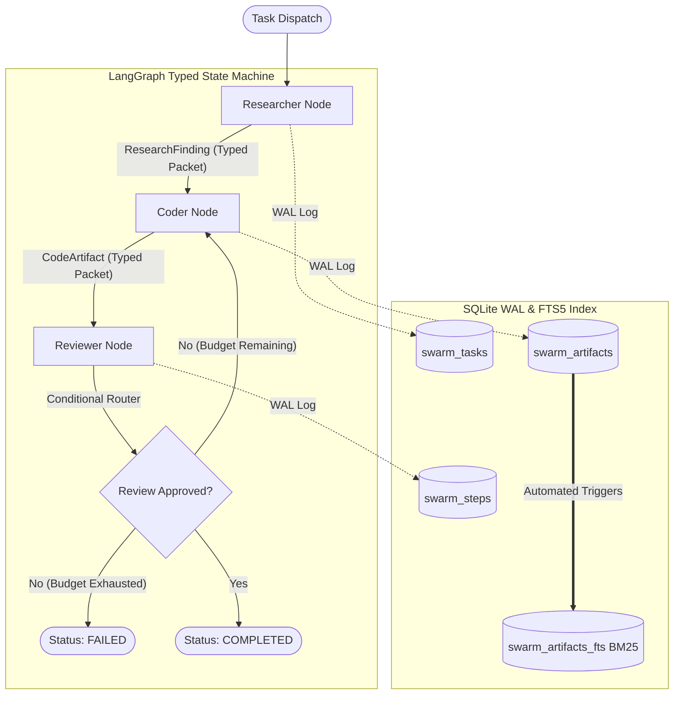

# Typed Multi-Agent Swarm

A production-grade multi-agent swarm architecture implementing a LangGraph state machine where specialized agents (**Researcher**, **Coder**, and **Reviewer**) communicate exclusively via strongly typed Pydantic v2 data transfer objects—never raw, unstructured strings.

---

## 1. Architectural Overview

In complex multi-agent workflows, untyped string communication creates non-deterministic failure modes, unparseable outputs, and silent state corruption. This repository demonstrates a resilient alternative:
- **Strictly Typed State Machine**: Every node consumes and emits validated Pydantic schemas (`ResearchFinding`, `CodeArtifact`, and `ReviewAssessment`).
- **Cyclic Feedback & Remediation**: If the Reviewer rejects a code artifact, the Coder receives structured critiques and actionable fixes to rewrite the implementation.
- **Enterprise Persistence**: SQLite Write-Ahead Logging (WAL) mode enables concurrent read/write transactions without database locks.
- **Full-Text Retrieval**: An external-content SQLite FTS5 index with automated synchronization triggers provides Porter-stemmed BM25 search over all emitted artifacts.



---

## 2. Typed State Packet Schemas

Agents pass strictly validated Pydantic v2 domain models:

### `ResearchFinding`
```python
class ResearchFinding(BaseModel):
    topic: str
    key_points: list[str]
    recommendations: list[str]
    confidence: float  # 0.0 <= confidence <= 1.0
    created_at: str
```

### `CodeArtifact`
```python
class CodeArtifact(BaseModel):
    filename: str
    language: str
    code: str
    test_cases: str
    dependencies: list[str]
    created_at: str
```

### `ReviewAssessment`
```python
class ReviewAssessment(BaseModel):
    approved: bool
    score: float  # 0.0 <= score <= 100.0
    critiques: list[str]
    suggested_fixes: list[str]
    created_at: str
```

---

## 3. SQLite WAL Mode and FTS5 Sync

The storage engine implements enterprise SQLite pragmas:
```sql
PRAGMA journal_mode = WAL;
PRAGMA synchronous = NORMAL;
PRAGMA foreign_keys = ON;
PRAGMA busy_timeout = 5000;
```

Full-text search is synchronized across relational tables via database triggers:
```sql
CREATE TRIGGER swarm_artifacts_ai AFTER INSERT ON swarm_artifacts BEGIN
    INSERT INTO swarm_artifacts_fts(rowid, artifact_id, task_id, artifact_type, title, content)
    VALUES (new.rowid, new.artifact_id, new.task_id, new.artifact_type, new.title, new.content);
END;
```

---

## 4. REST API Contract

| Method | Path | Description |
|---|---|---|
| `POST` | `/swarm/dispatch` | Dispatches task through LangGraph state machine |
| `GET` | `/swarm/tasks/{task_id}` | Retrieves full state, typed packets, and audit trail |
| `GET` | `/swarm/search?q={query}` | BM25 search across artifacts via SQLite FTS5 |
| `GET` | `/health/live` | Container liveness check |
| `GET` | `/health/ready` | Database readiness check |

---

## 5. Local Setup & Testing (WSL2 / Linux / macOS)

### Prerequisites
- Python 3.11+
- SQLite 3.35+ (with FTS5 support)

### Installation
```bash
python -m venv .venv
source .venv/bin/activate
pip install -r requirements.txt
```

### Running Tests
Execute the 5-tier Pytest suite:
```bash
python -m pytest tests/ -v
```

---

## 6. Docker & AWS EC2 Deployment

### Build and Run with Docker Compose
```bash
docker-compose up -d --build
```

### Healthcheck Verification
```bash
curl -f http://localhost:8000/health/live
curl -f http://localhost:8000/health/ready
```

---

## 7. Example Usage (cURL)

### Dispatch a Multi-Agent Swarm Task
```bash
curl -X POST http://localhost:8000/swarm/dispatch \
  -H "Content-Type: application/json" \
  -d '{
    "task_description": "Build high-throughput sharded key-value store",
    "context": "Consistent hashing with virtual nodes",
    "max_iterations": 3
  }'
```

### Search Swarm Artifacts
```bash
curl "http://localhost:8000/swarm/search?q=hashing&limit=5"
```
