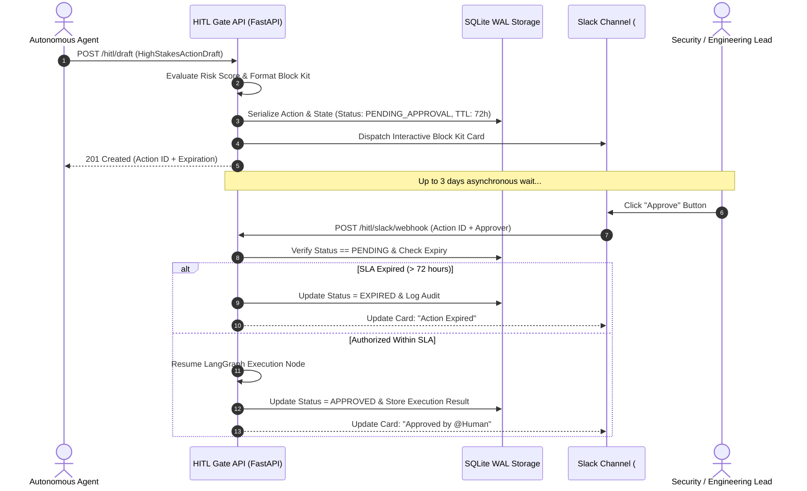
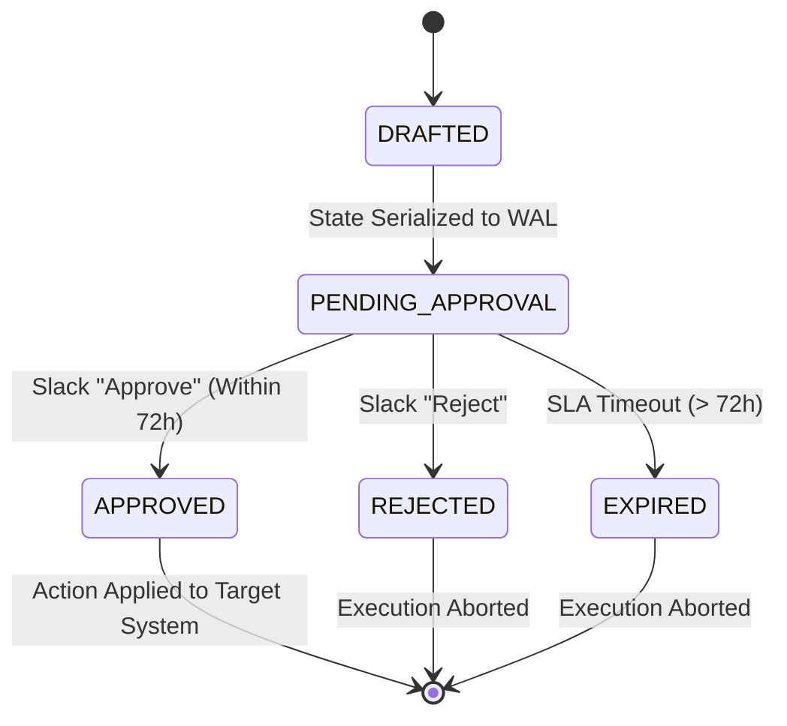

# Async HITL Slack Gate

A resilient Human-in-the-Loop (HITL) gate architecture that drafts high-stakes agent actions, serializes the workflow state into SQLite WAL, posts interactive Slack Block Kit approval cards, and safely waits up to 3 days for human sign-off via asynchronous webhooks.

---

## 1. Architectural Overview

High-stakes autonomous operations (production rollouts, destructive database migrations, privileged access grants, mass billing modifications) must never execute without explicit human authorization. This service decouples synchronous LLM execution from asynchronous human approvals:
- **State Serialization**: High-stakes action drafts are serialized into an ACID-compliant SQLite WAL database.
- **Interactive Slack Integration**: Generates Slack Block Kit payloads featuring primary ("Approve") and danger ("Reject") action buttons.
- **3-Day SLA Timeout Guard**: Automatic state machine expiration if no human interacts within the 72-hour window.
- **Full-Text Audit Search**: SQLite FTS5 index with automated synchronization triggers provides full BM25 search across all reviewer justifications and execution audits.



---

## 2. State Machine Flow



---

## 3. SQLite WAL and FTS5 Sync Triggers

```sql
PRAGMA journal_mode = WAL;
PRAGMA synchronous = NORMAL;
PRAGMA foreign_keys = ON;
PRAGMA busy_timeout = 5000;

CREATE TRIGGER hitl_audits_ai AFTER INSERT ON hitl_audits BEGIN
    INSERT INTO hitl_audits_fts(rowid, audit_id, action_id, decision, approver_id, note)
    VALUES (new.rowid, new.audit_id, new.action_id, new.decision, new.approver_id, new.note);
END;
```

---

## 4. API Endpoints

| Method | Path | Description |
|---|---|---|
| `POST` | `/hitl/draft` | Drafts and serializes high-stakes action into SQLite WAL |
| `POST` | `/hitl/slack/webhook` | Receives Slack interactive webhook button payloads |
| `GET` | `/hitl/actions/{action_id}` | Fetches serialized action, state, and execution result |
| `GET` | `/hitl/search?q={query}` | BM25 full-text search across audit logs via SQLite FTS5 |
| `GET` | `/health/live` | Process liveness health check |
| `GET` | `/health/ready` | SQLite readiness check |

---

## 5. Local Setup & Testing

### Installation
```bash
python -m venv .venv
source .venv/bin/activate
pip install -r requirements.txt
```

### Running Test Suite
```bash
python -m pytest tests/ -v
```

---

## 6. Docker & AWS EC2 Deployment

```bash
docker-compose up -d --build
```
