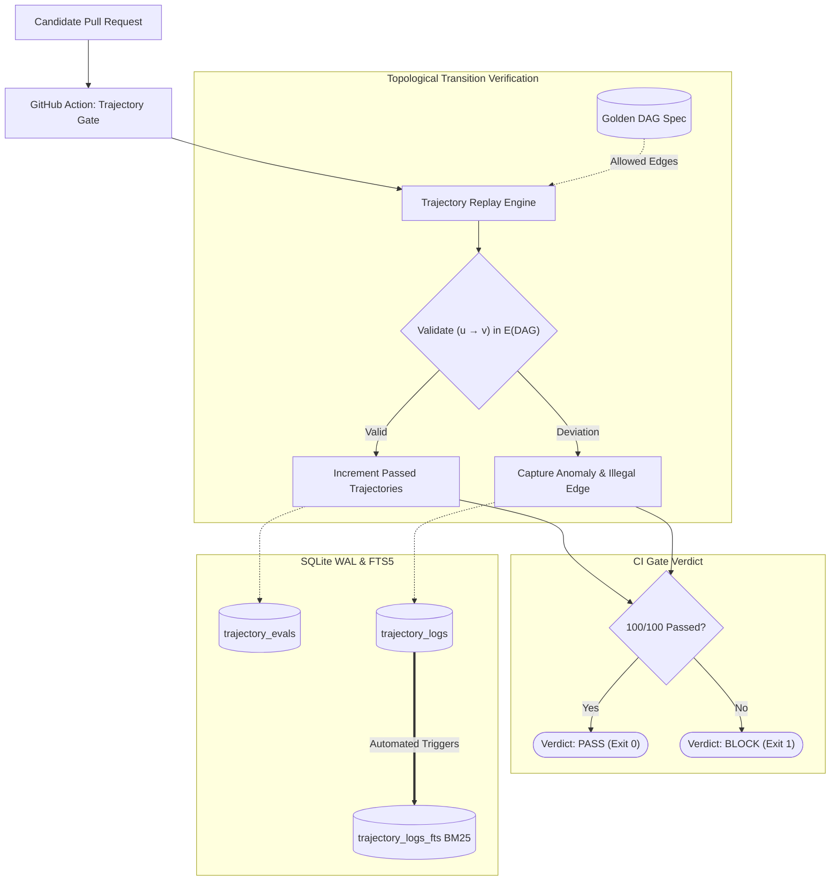

# Trajectory Eval CI Gate

A continuous integration (CI) gate and replay engine that replays 100+ autonomous agent execution trajectories against a formal **Golden DAG** (Directed Acyclic Graph) and automatically blocks Pull Requests (PRs) if candidate agent tool-call transitions deviate from the verified execution graph.

---

## 1. Architectural Overview

Agentic software often suffers from behavioral regression where updated system prompts, model weights, or tool descriptions cause the agent to execute unexpected, risky, or invalid tool-calling sequences. This service establishes a deterministic CI regression barrier:
- **Golden DAG Specification**: Defines strictly authorized agent tool calls, initial entry points, terminal exit states, and legal state transitions $(u \to v)$.
- **100-Trajectory Replay Engine**: Replays recorded candidate PR trajectories against the topological graph in parallel.
- **Automated PR Blocker**: Emits a `BLOCK` verdict with granular deviation reports if illegal transitions or skipped validation hops are detected.
- **Enterprise SQLite WAL & FTS5**: All trajectory execution logs and deviation diagnoses are persisted under Write-Ahead Logging and indexed for BM25 search.



---

## 2. GitHub Actions Workflow

The CI workflow is configured under `.github/workflows/trajectory-gate.yml`:
```yaml
name: Agent Trajectory Evaluation CI Gate
on: [pull_request]
jobs:
  replay-trajectories:
    runs-on: ubuntu-latest
    steps:
      - uses: actions/checkout@v4
      - uses: actions/setup-python@v5
        with:
          python-version: "3.11"
      - run: pip install -r requirements.txt
      - run: python -m pytest tests/ -v
      - run: python -m app.cli_eval --dag-id golden-default --num-trajectories 100 --fail-on-deviation
```

---

## 3. SQLite WAL Mode and FTS5 Sync

```sql
PRAGMA journal_mode = WAL;
PRAGMA synchronous = NORMAL;
PRAGMA foreign_keys = ON;
PRAGMA busy_timeout = 5000;

CREATE TRIGGER trajectory_logs_ai AFTER INSERT ON trajectory_logs BEGIN
    INSERT INTO trajectory_logs_fts(rowid, log_id, eval_id, trajectory_id, deviation_reason, tool_sequence_json)
    VALUES (new.rowid, new.log_id, new.eval_id, new.trajectory_id, new.deviation_reason, new.tool_sequence_json);
END;
```

---

## 4. REST API Contract

| Method | Path | Description |
|---|---|---|
| `POST` | `/ci/evaluate` | Evaluates candidate PR trajectories against the Golden DAG |
| `POST` | `/ci/golden-dag` | Registers or updates a Golden DAG topology |
| `GET` | `/ci/evals/{eval_id}` | Retrieves full evaluation metrics and trajectory logs |
| `GET` | `/ci/search?q={query}` | BM25 search across trajectory logs via SQLite FTS5 |
| `GET` | `/health/live` | Process liveness check |
| `GET` | `/health/ready` | SQLite readiness check |

---

## 5. Local Setup & Testing

### Installation
```bash
python -m venv .venv
source .venv/bin/activate
pip install -r requirements.txt
```

### Running Test Suite
```bash
python -m pytest tests/ -v
```

### CLI Trajectory Gate Verification
```bash
python -m app.cli_eval --dag-id golden-default --num-trajectories 100
```

---

## 6. Docker & AWS EC2 Deployment

```bash
docker-compose up -d --build
```
