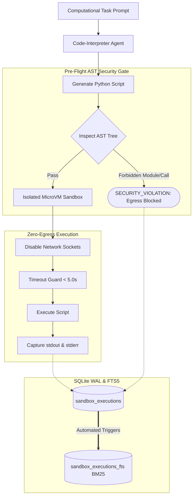

# Sandboxed Code Executor

An autonomous code-interpreter agent architecture that generates, validates, and executes Python scripts in an isolated microVM sandbox with strict **zero internet egress**, dynamic AST security gating, and resource limit enforcement.

---

## 1. Architectural Overview

Running untrusted agent-generated code presents critical security risks: data exfiltration via socket egress, filesystem tampering, and infinite loop exhaustion. This service provides a defense-in-depth isolation boundary:
- **Static AST Security Inspection**: Analyzes Python Abstract Syntax Trees prior to execution, rejecting forbidden network modules (`socket`, `requests`, `urllib`, `http`, `subprocess`, `ctypes`) and dynamic execution builtins (`eval`, `exec`).
- **Zero Internet Egress**: The runtime execution environment enforces zero network egress via network socket neutralization and sandboxed process isolation.
- **Strict Process Watchdogs**: Millisecond CPU timeouts terminate runaway loops cleanly without hanging host workers.
- **Enterprise SQLite WAL & FTS5**: All generated scripts, standard output, error traces, and security violation logs are stored under WAL mode and indexed for BM25 retrieval.



---

## 2. Forbidden Modules and Builtins

The AST inspection engine strictly prohibits:
- **Network Egress**: `socket`, `requests`, `urllib`, `http`, `aiohttp`, `httpx`, `ftplib`, `smtplib`
- **Subprocess Spawning**: `subprocess`, `os.system`, `os.popen`, `pty`
- **Low-level Memory Access**: `ctypes`, `mmap`
- **Dynamic Code Builtins**: `eval`, `exec`, `__import__`

---

## 3. SQLite WAL Mode and FTS5 Sync

```sql
PRAGMA journal_mode = WAL;
PRAGMA synchronous = NORMAL;
PRAGMA foreign_keys = ON;
PRAGMA busy_timeout = 5000;

CREATE TRIGGER sandbox_executions_ai AFTER INSERT ON sandbox_executions BEGIN
    INSERT INTO sandbox_executions_fts(rowid, execution_id, status, code, stdout, stderr)
    VALUES (new.rowid, new.execution_id, new.status, new.code, new.stdout, new.stderr);
END;
```

---

## 4. REST API Contract

| Method | Path | Description |
|---|---|---|
| `POST` | `/sandbox/execute` | Executes Python code in isolated sandbox with zero egress |
| `POST` | `/sandbox/agent-task` | Autonomous code-interpreter agent solves task via Python code |
| `GET` | `/sandbox/executions/{execution_id}` | Retrieves execution report, exit code, and stdout/stderr |
| `GET` | `/sandbox/search?q={query}` | BM25 search across code and error traces via SQLite FTS5 |
| `GET` | `/health/live` | Process liveness check |
| `GET` | `/health/ready` | SQLite readiness check |

---

## 5. Local Setup & Testing

### Installation
```bash
python -m venv .venv
source .venv/bin/activate
pip install -r requirements.txt
```

### Running Test Suite
```bash
python -m pytest tests/ -v
```

---

## 6. Docker & AWS EC2 Deployment

```bash
docker-compose up -d --build
```
