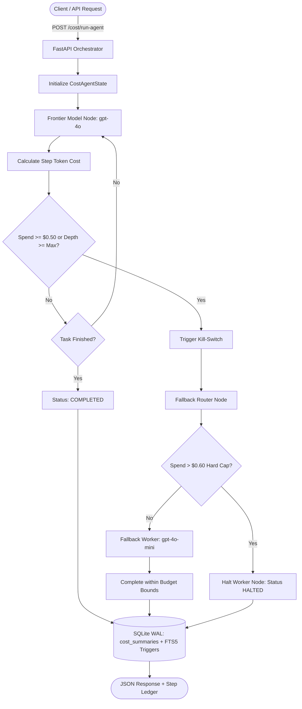

# 12-cost-kill-switch-middleware

> Real-time token tracking and cost kill-switch middleware built with FastAPI, LangGraph, and SQLite WAL mode, halting runaway agent loops at $0.50 and falling back to economical LLM models.

[](https://python.org)
[](https://fastapi.tiangolo.com)
[](https://langchain-ai.github.io/langgraph/)
[](https://sqlite.org)
[](https://www.docker.com/)

---

## 1. Architectural Overview

The **Cost Kill-Switch Middleware** acts as an active circuit breaker for autonomous agent loops. It computes exact token spend per inference hop, tracks loop depth, and enforces a strict **$0.50 per-task spending limit**. When projected or cumulative costs exceed this threshold, the middleware halts execution of the frontier model (`gpt-4o`) and dynamically routes remaining operations to an economical fallback tier (`gpt-4o-mini`).



---

## 2. Core Capabilities

- **Real-Time Step Cost Accounting**: Computes prompt and completion token expenditure per step using model-specific rate cards.
- **$0.50 Circuit Breaker Threshold**: Instant kill-switch tripping on threshold violation, preventing runaway LLM bills.
- **Dynamic Tier Fallback**: Seamless fallback from frontier models (`gpt-4o`) to budget models (`gpt-4o-mini`) without losing prior context or state.
- **Audit Ledger in SQLite WAL**: Every token hop, step latency, model transition, and spend delta is recorded in an immutable ledger with full-text search (FTS5).
- **RFC 7807 Problem Details**: Standardized structured JSON responses for API error handling.

---

## 3. Technology Stack

- **Backend & Orchestration**: Python 3.11+, FastAPI (with asyncio), Pydantic v2, LangGraph.
- **State Management**: SQLite configured with Write-Ahead Logging (`WAL`), `synchronous = NORMAL`, `foreign_keys = ON`, `busy_timeout = 5000`, and Porter-stemmed FTS5 virtual tables with automated triggers.
- **Deployment**: Multi-stage Docker container with non-root security context.

---

## 4. Quickstart

### Prerequisites
- Python 3.11+
- Virtual environment tool (`venv` or `uv`)

### Local Setup
```bash
# Clone and enter directory
cd 12-cost-kill-switch-middleware

# Create and activate virtual environment
python -m venv .venv
source .venv/bin/activate  # Windows: .venv\Scripts\activate

# Install dependencies
pip install -r requirements.txt

# Run test suite
pytest
```

### Running with Docker
```bash
docker compose up --build
```

---

## 5. API Reference

| Method | Path | Description |
|---|---|---|
| `GET` | `/health` | Service health status |
| `POST` | `/cost/run-agent` | Execute an agent task under cost kill-switch protection |
| `GET` | `/cost/pricing-table` | Inspect current token pricing schedules |
| `GET` | `/cost/search?q={query}` | BM25 full-text search across past execution logs |
| `GET` | `/cost/{request_id}` | Retrieve single task run summary and complete step ledger |
