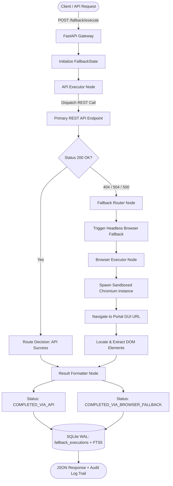

# 13-api-to-browser-fallback-agent

> Autonomous routing layer that seamlessly spawns a headless browser session to complete GUI workflows whenever primary REST APIs encounter 404s, timeouts, or service interruptions.

[](https://python.org)
[](https://fastapi.tiangolo.com)
[](https://langchain-ai.github.io/langgraph/)
[](https://sqlite.org)
[](https://www.docker.com/)

---

## 1. Architectural Overview

Production agent systems often depend on internal REST APIs that can fail due to stale route documentation, unindexed records, gateway timeouts, or deployment drift. The **API-to-Browser Fallback Agent** implements an automated resilience layer:
1. It attempts fast, structured data extraction via the primary REST API.
2. If the API returns a `404 Not Found`, `504 Gateway Timeout`, or `500 Internal Error`, a LangGraph conditional edge intercepts the failure.
3. The agent spawns a sandboxed headless browser session, navigates directly to the web portal GUI, locates the corresponding DOM selectors, extracts the structured entity, and logs the entire fallback path in SQLite WAL.



---

## 2. Core Capabilities

- **Zero-Drop Workflow Completion**: Workflows never fail because of an unindexed API record; the GUI portal is automatically leveraged as a high-fidelity fallback.
- **Automated DOM Scraping & Extraction**: Extracts structured fields from rendered React/Next.js portal views.
- **Immutable Audit Trail in SQLite WAL**: Every dispatch hop, HTTP status code, browser session ID, DOM selector, and timing metric is logged with FTS5 search.
- **RFC 7807 Error Standard**: Problem Details returned for all validation and missing record lookups.

---

## 3. Technology Stack

- **Backend & Orchestration**: Python 3.11+, FastAPI (with asyncio), Pydantic v2, LangGraph.
- **State Management**: Native SQLite with Write-Ahead Logging (`WAL`), `synchronous = NORMAL`, `foreign_keys = ON`, `busy_timeout = 5000`, and Porter-stemmed FTS5 virtual tables with automated triggers.
- **Containerization**: Multi-stage Docker container configured for AWS EC2 and WSL2 Ubuntu deployment.

---

## 4. Quickstart

### Local Setup
```bash
# Clone and navigate
cd 13-api-to-browser-fallback-agent

# Virtual environment setup
python -m venv .venv
source .venv/bin/activate  # Windows: .venv\Scripts\activate

# Install dependencies
pip install -r requirements.txt

# Run pytest validation
pytest
```

### Docker Deployment
```bash
docker compose up --build
```

---

## 5. API Reference

| Method | Path | Description |
|---|---|---|
| `GET` | `/health` | Service health status |
| `POST` | `/fallback/execute` | Execute workflow with automatic API-to-browser fallback |
| `GET` | `/fallback/search?q={term}` | BM25 full-text search across past execution logs |
| `GET` | `/fallback/{execution_id}` | Retrieve single execution record and sequential audit log trail |
