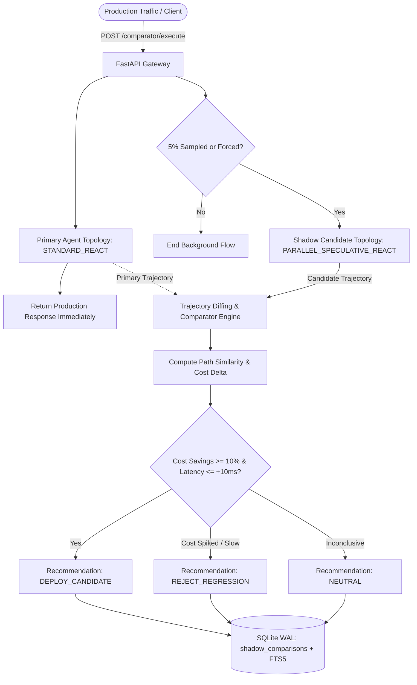

# 14-shadow-trajectory-comparator

> Silent 5% traffic mirror that executes candidate agent topologies in the shadow plane, diffing tool-call paths, latencies, and token costs against production without impacting user SLA.

[](https://python.org)
[](https://fastapi.tiangolo.com)
[](https://langchain-ai.github.io/langgraph/)
[](https://sqlite.org)
[](https://www.docker.com/)

---

## 1. Architectural Overview

Deploying updated agent topologies, new prompting strategies, or altered tool graphs directly to production carries substantial risk of regression in token cost, latency, or tool selection accuracy.

The **Shadow Trajectory Comparator** provides a zero-risk validation gate:
1. Production traffic is handled synchronously by the existing primary agent topology (`STANDARD_REACT`), returning responses immediately to the caller.
2. A configurable fraction of traffic (default **5%**) is sampled into a background shadow execution plane.
3. The candidate topology (`PARALLEL_SPECULATIVE_REACT`) executes against the exact same input context.
4. A diffing engine compares tool call sequences (Jaccard similarity), token costs, and wall-clock latencies, producing an automated recommendation (`DEPLOY_CANDIDATE`, `REJECT_REGRESSION`, `NEUTRAL`) persisted in SQLite WAL.



---

## 2. Core Capabilities

- **Non-Blocking Shadow Mirroring**: Production callers experience zero latency overhead; candidate topologies execute without affecting user experience.
- **Trajectory Path Alignment**: Measures tool graph convergence and divergence using set similarity and sequence alignment.
- **Automated Regression Triage**: Instantly flags runaway token consumption or tool execution loops before candidate code is promoted.
- **Full-Text Search (FTS5)**: Query historical shadow comparisons using Porter-stemmed BM25 search.
- **RFC 7807 Compliance**: Clean structured error responses across all endpoints.

---

## 3. Technology Stack

- **Backend & Orchestration**: Python 3.11+, FastAPI (with asyncio), Pydantic v2, LangGraph.
- **State Management**: SQLite with Write-Ahead Logging (`WAL`), `synchronous = NORMAL`, `foreign_keys = ON`, `busy_timeout = 5000`, and Porter-stemmed FTS5 virtual tables with automated triggers.
- **Infrastructure**: Multi-stage Docker containerization configured for AWS EC2 and WSL2 Ubuntu deployment.

---

## 4. Quickstart

### Local Setup
```bash
# Navigate to directory
cd 14-shadow-trajectory-comparator

# Virtual environment setup
python -m venv .venv
source .venv/bin/activate  # Windows: .venv\Scripts\activate

# Install dependencies
pip install -r requirements.txt

# Run pytest validation
pytest
```

### Docker Deployment
```bash
docker compose up --build
```

---

## 5. API Reference

| Method | Path | Description |
|---|---|---|
| `GET` | `/health` | Service health status |
| `POST` | `/comparator/execute` | Ingest agent traffic and trigger shadow comparison if sampled |
| `GET` | `/comparator/comparisons` | List recent trajectory comparisons and diff summaries |
| `GET` | `/comparator/search?q={query}` | BM25 full-text search across past comparison reports |
| `GET` | `/comparator/{comparison_id}` | Retrieve full diff metrics and deployment recommendation |
