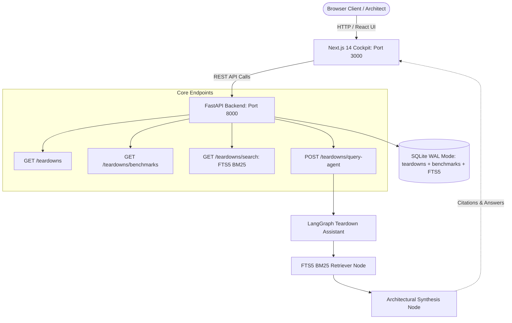

# 15-public-architecture-teardown

> Public architectural teardown cockpit and deep-dives detailing swarm topologies, state-machine invariants, inter-agent security boundaries, and cost-per-task economics across 15 production repositories.

[](https://python.org)
[](https://fastapi.tiangolo.com)
[](https://nextjs.org/)
[](https://www.typescriptlang.org/)
[](https://langchain-ai.github.io/langgraph/)
[](https://sqlite.org)
[](https://www.docker.com/)

---

## 1. Architectural Overview

The **Public Architecture Teardown** acts as both an operational cockpit and a published technical resource. It features:
- **3 Interactive Published Deep-Dives**:
  1. *Swarm Topology & LangGraph State Machine Invariants*: Eliminating hallucinations with strictly typed Pydantic payloads and cyclic depth boundaries.
  2. *Inter-Agent Sanitization & Isolated Code Execution*: Scrubbing cross-agent prompt injections and neutralizing socket egress in sandboxed runtimes.
  3. *Real-Time Cost Kill-Switches & Shadow Trajectory Diffing*: $0.50 spending circuit breakers with fallback models, coupled with silent 5% shadow traffic mirrors.
- **Operations Cockpit Frontend**: Modern Next.js 14, React, and TypeScript interface with live benchmark cards, search, and an interactive LangGraph query terminal.
- **Unified Knowledge Search**: Porter-stemmed BM25 search powered by SQLite FTS5 with automated sync triggers.



---

## 2. Published Architectural Deep Dives

### Deep Dive 1: Swarm Topology & LangGraph State Machine Invariants
Focuses on transitioning from brittle string-based prompting to strictly typed Pydantic v2 schemas (`ResearchFinding`, `CodeArtifact`, `ReviewAssessment`). Demonstrates state checkpointing in SQLite WAL and cycle mitigation.

### Deep Dive 2: Inter-Agent Sanitization & Isolated Code Execution
Analyzes the lateral prompt injection threat vector in multi-agent environments. Documents the sanitization proxy middleware, regex tag stripping, risk threshold quarantine, and zero-internet socket neutralization.

### Deep Dive 3: Real-Time Cost Kill-Switches & Shadow Trajectory Diffing
Dissects agent loops exceeding spending budgets. Establishes the $0.50 cost circuit breaker falling back from `gpt-4o` to `gpt-4o-mini`, alongside 5% shadow traffic mirroring diffing tool-call DAGs.

---

## 3. Technology Stack

- **Backend & Orchestration**: Python 3.11+, FastAPI (with asyncio), Pydantic v2, LangGraph.
- **Frontend Dashboard**: Next.js 14, React 18, TypeScript 5.6.
- **State Management**: SQLite with Write-Ahead Logging (`WAL`), `synchronous = NORMAL`, `foreign_keys = ON`, `busy_timeout = 5000`, and Porter-stemmed FTS5 virtual tables with automated triggers.
- **Deployment**: Multi-stage Docker containerization for both backend and frontend, ready for AWS EC2 and WSL2 Ubuntu deployment.

---

## 4. Quickstart

### Backend Setup
```bash
# Enter project directory
cd 15-public-architecture-teardown

# Virtual environment
python -m venv .venv
source .venv/bin/activate  # Windows: .venv\Scripts\activate

# Install dependencies
pip install -r requirements.txt

# Run pytest validation
pytest
```

### Frontend Setup
```bash
cd 15-public-architecture-teardown/frontend

# Install dependencies
npm install

# Start Next.js development server
npm run dev
```

### Docker Compose
```bash
docker compose up --build
```
Access the cockpit at `http://localhost:3000` and API docs at `http://localhost:8000/docs`.

---

## 5. API Reference

| Method | Path | Description |
|---|---|---|
| `GET` | `/health` | Service health status |
| `GET` | `/teardowns` | List all 3 published architectural deep dives |
| `GET` | `/teardowns/benchmarks` | Production benchmarks across all 15 repositories |
| `GET` | `/teardowns/search?q={term}` | BM25 search across deep-dive texts |
| `POST` | `/teardowns/query-agent` | Query the LangGraph architectural teardown assistant |
| `GET` | `/teardowns/{slug}` | Retrieve single deep dive by unique slug |
