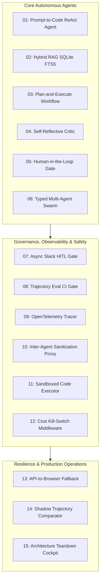

# 15 Tools: Production Agentic AI Engineering Repository

[](https://www.python.org/)
[](https://fastapi.tiangolo.com/)
[](https://github.com/langchain-ai/langgraph)
[](https://sqlite.org/)
[](https://docs.pytest.org/)
[](LICENSE)

A comprehensive suite of 15 standalone, production-grade agentic AI engineering architectures, microservices, and design patterns. Each tool is built with **FastAPI**, **LangGraph**, **Pydantic v2**, **SQLite (WAL mode + FTS5)**, and containerized Docker configurations, backed by exhaustive Pytest test suites.

---

## Architecture Overview



---

## Repository Catalog

| # | Directory | Name & Architecture | Key Technologies |
|---|---|---|---|
| **01** | [`01-prompt-to-code-react-agent`](./01-prompt-to-code-react-agent) | **Prompt-to-Code ReAct Agent**<br>ReAct loop with AST validation, dynamic code execution, and SQLite WAL run telemetry. | FastAPI, LangGraph, SQLite WAL, AST Validator |
| **02** | [`02-rag-hybrid-sqlite-fts5-agent`](./02-rag-hybrid-sqlite-fts5-agent) | **RAG Hybrid SQLite FTS5 Agent**<br>Reciprocal Rank Fusion (RRF) combining dense vector embeddings with SQLite FTS5 BM25 search. | SQLite FTS5, Vector Embeddings, RRF, FastAPI |
| **03** | [`03-plan-and-execute-workflow-agent`](./03-plan-and-execute-workflow-agent) | **Plan-and-Execute Workflow Agent**<br>Decomposes complex requests into directed task DAGs with replanning upon step failure. | LangGraph StateGraph, Dependency DAG, Pydantic |
| **04** | [`04-self-reflective-critic-agent`](./04-self-reflective-critic-agent) | **Self-Reflective Critic Agent**<br>Dual-agent Actor-Critic pattern with iterative self-critique, rubric evaluation, and convergence guardrails. | LangGraph, Actor-Critic, Convergence Thresholding |
| **05** | [`05-human-in-the-loop-approval-agent`](./05-human-in-the-loop-approval-agent) | **Human-in-the-Loop Approval Agent**<br>Synchronous/tokenized approval workflows with persistent pause/resume state and audit logging. | LangGraph Interrupts, SQLite WAL, FastAPI |
| **06** | [`06-typed-multi-agent-swarm`](./06-typed-multi-agent-swarm) | **Typed Multi-Agent Swarm**<br>Researcher, Coder, and Reviewer multi-agent swarm communicating strictly via typed Pydantic v2 models. | Pydantic v2, Multi-Agent Swarm, LangGraph |
| **07** | [`07-async-hitl-slack-gate`](./07-async-hitl-slack-gate) | **Async HITL Slack Gate**<br>Durable asynchronous approval gate dispatching interactive Slack Block Kit cards with webhook resumption. | Slack Block Kit, SQLite Checkpointing, Webhooks |
| **08** | [`08-trajectory-eval-ci-gate`](./08-trajectory-eval-ci-gate) | **Trajectory Eval CI Gate**<br>Automated CI gate replaying agent execution trajectories against reference golden DAGs to block regressive PRs. | CI/CD Gate, Golden DAGs, Trajectory Replay |
| **09** | [`09-opentelemetry-agent-tracer`](./09-opentelemetry-agent-tracer) | **OpenTelemetry Agent Tracer**<br>Distributed agent tracing engine capturing spans across LLM hops, tool calls, and state transitions. | OpenTelemetry, LangSmith/Arize Schema, Tracing |
| **10** | [`10-inter-agent-sanitization-proxy`](./10-inter-agent-sanitization-proxy) | **Inter-Agent Sanitization Proxy**<br>Zero-trust security proxy filtering prompt injections, adversarial overrides, and data exfiltration vectors. | Security Middleware, Regex/Regex-free Sanitizers |
| **11** | [`11-sandboxed-code-executor`](./11-sandboxed-code-executor) | **Sandboxed Code Executor**<br>Isolated containerized micro-sandbox with resource quotas, memory caps, AST screening, and zero internet egress. | Docker Isolation, Resource Limits, Security AST |
| **12** | [`12-cost-kill-switch-middleware`](./12-cost-kill-switch-middleware) | **Cost Kill-Switch Middleware**<br>Real-time token & cost tracking middleware with automatic kill switches at budget ceilings and fallback model routing. | Token Counting, Budget Enforcers, Circuit Breakers |
| **13** | [`13-api-to-browser-fallback-agent`](./13-api-to-browser-fallback-agent) | **API to Browser Fallback Agent**<br>Resilient agent routing layer falling back to headless browser automation when primary APIs experience outages. | Headless Automation, Fallback Routing, Playwright |
| **14** | [`14-shadow-trajectory-comparator`](./14-shadow-trajectory-comparator) | **Shadow Trajectory Comparator**<br>Traffic mirroring engine executing candidate agents in shadow mode to diff latency, pathing, and cost against production. | Traffic Shadowing, Metric Diffing, SQLite WAL |
| **15** | [`15-public-architecture-teardown`](./15-public-architecture-teardown) | **Public Architecture Teardown**<br>Interactive architectural teardown dashboard comparing topologies, cost benchmarks, and state machines. | Next.js/React, FastAPI, Architectural Visualizer |

---

## Tech Stack Standards

All repositories across this suite enforce standard production standards:
- **Language & Runtime:** Python 3.11+
- **API Framework:** FastAPI with asynchronous endpoints & OpenAPI documentation
- **State Machine & Orchestration:** LangGraph `StateGraph` with explicit state schemas
- **Data Validation & Contracts:** Pydantic v2 models
- **Database & Storage:** SQLite with Write-Ahead Logging (`PRAGMA journal_mode=WAL`) and FTS5 full-text indexing where applicable
- **Testing:** Pytest test suites covering happy paths, edge cases, and failure modes
- **Containerization:** Dockerfile and `docker-compose.yml` for isolated containerized runs

---

## Quick Start

### 1. Clone the Repository
```bash
git clone https://github.com/Cappuccino-san/15_Tools.git
cd 15_Tools
```

### 2. Running Any Subproject
Navigate to any individual tool directory and review its dedicated `README.md`:

```bash
cd 01-prompt-to-code-react-agent

# Set up virtual environment
python -m venv .venv
source .venv/bin/activate  # On Windows: .venv\Scripts\activate

# Install dependencies
pip install -r requirements.txt

# Run tests
pytest
```

---

## License

This project is licensed under the MIT License.
